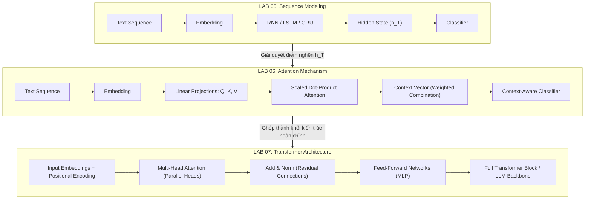

# LAB 06 — Attention Mechanism: Reflection, Systematic Comparison & Defense Preparation

**Môn học:** Xử lý ngôn ngữ tự nhiên và ứng dụng (Natural Language Processing)  
**Học kỳ:** Học kỳ I - 2026 | **Đại học Khoa học Tự nhiên - ĐHQGHN**  
**Giảng viên / TA:** Phạm Ngọc Hải  
**Chủ đề:** *From Recurrent State to Context-Aware Representation*  

---

## Mục lục
1. [So sánh Hệ thống LAB 05 và LAB 06 (Section 28)](#1-so-sánh-hệ-thống-lab-05-và-lab-06-section-28)
2. [Chiêm nghiệm: "Attention Không Miễn Phí" và Giới hạn Bậc hai (Section 29)](#2-chiêm-nghiệm-attention-không-miễn-phí-và-giới-hạn-bậc-hai-section-29)
3. [Mạch Nối Kiến thức: LAB 05 → LAB 06 → LAB 07 (Section 35)](#3-mạch-nối-kiến-thức-lab-05--lab-06--lab-07-section-35)
4. [Bộ Câu hỏi Kiểm tra Cá nhân - Individual Learning Check (Section 31)](#4-bộ-câu-hỏi-kiểm-tra-cá-nhân---individual-learning-check-section-31)
5. [Tuyên bố Sử dụng Trí tuệ Nhân tạo - AI Assistance Statement (Section 30)](#5-tuyên-bố-sử-dụng-trí-tuệ-nhân-tạo---ai-assistance-statement-section-30)

---

## 1. So sánh Hệ thống LAB 05 và LAB 06 (Section 28)

### 1.1. Bảng Đối chiếu Đặc tính Kiến trúc

| Thuộc tính (Property) | Mô hình Tuần tự (RNN / LSTM / GRU - LAB 05) | Cơ chế Chú ý (Self-Attention - LAB 06) |
| :--- | :---: | :---: |
| **Sequence Order** | Có (bản chất tuần tự $t=1 \dots T$) | Không tự nhiên (Cần Positional Encoding) |
| **Hidden State** | Bắt buộc ($h_t \in \mathbb{R}^d$) | Không bắt buộc (Truy cập trực tiếp ma trận) |
| **Sequential Computation** | Bắt buộc (bước $t$ chờ bước $t-1$) | Không bắt buộc (Song song hóa hoàn toàn) |
| **Direct Token-to-Token** | Rất hạn chế (phải truyền qua chuỗi) | Có (Mọi cặp token tương tác trực tiếp $\mathcal{O}(1)$) |
| **Long-Range Interaction** | Khó khăn (Vanishing/Exploding Gradient) | Dễ dàng (Đường truyền gradient độ dài 1) |
| **Parallel Computation** | Hạn chế (Nghẽn theo chiều thời gian) | Song song hóa hoàn hảo trên GPU ($\text{BMM}$) |
| **Cost theo Sequence Length** | Tuyến tính $\mathcal{O}(T)$ theo bước thời gian | Bậc hai $\mathcal{O}(T^2)$ cho Full Self-Attention |
| **Context Representation** | Vector trạng thái ẩn cuối cùng $h_T$ | Tổ hợp lồi động các Value: $c = \sum \alpha_i v_i$ |

---

### 1.2. Trả lời Hai Câu hỏi Trọng tâm của Section 28

#### Câu hỏi 1: Attention giải quyết vấn đề gì của Recurrent Processing?
1. **Xóa bỏ nút thắt cổ chai thông tin (Eliminates Information Bottleneck):**  
   Trong RNN/LSTM, toàn bộ ngữ cảnh của câu bị ép nén vào một vector $h_T$ duy nhất. Khi câu dài hoặc có nhiều mệnh đề, các chi tiết ở đầu câu bị mờ nhạt dần. Attention cho phép mô hình lưu trữ và nhìn lại toàn bộ các trạng thái $\mathcal{H} = \{h_1, \dots, h_T\}$, chọn lọc thông tin theo nhu cầu của truy vấn (Query).
2. **Khoảng cách tương tác tối thiểu $\mathcal{O}(1)$ (Shortest Path for Gradients):**  
   Để liên kết giữa token ở vị trí 1 và vị trí 100 trong RNN, thông tin phải trải qua 99 phép biến đổi ma trận liên tiếp, khiến đạo hàm bị triệt tiêu (vanishing gradient). Trong Attention, khoảng cách giữa bất kỳ cặp token nào luôn là **1 bước**, gradient lan truyền trực tiếp không bị suy hao.
3. **Song song hóa huấn luyện (Training Parallelization):**  
   RNN không thể tính $h_t$ nếu chưa xong $h_{t-1}$. Ngược lại, ma trận Attention $QK^T$ được tính toán đồng thời cho mọi vị trí trong một phép nhân ma trận khối (Batch Matrix Multiplication - BMM), tận dụng tối đa hàng ngàn nhân Tensor Core của GPU.

#### Câu hỏi 2: Attention tạo ra vấn đề mới nào?
1. **Sự bùng nổ độ phức tạp bậc hai $\mathcal{O}(T^2)$:**  
   Chi phí tính toán FLOPs và bộ nhớ lưu ma trận trọng số tăng theo bình phương độ dài chuỗi. Khi $T$ lớn, GPU nhanh chóng rơi vào tình trạng tràn bộ nhớ (CUDA Out of Memory).
2. **Mất mát thứ tự từ vựng tự nhiên (Permutation Equivariance):**  
   Phép toán Attention có tính đối xứng vị trí: nếu hoán vị thứ tự các từ trong câu mà không có cơ chế bù đắp, mô hình sẽ không phân biệt được *"The dog bit the cat"* và *"The cat bit the dog"*. Attention bắt buộc phải cần thêm Positional Encoding (LAB 07).
3. **Tổ hợp lồi tuyến tính thiếu khả năng suy luận logic:**  
   Context vector thu được vẫn chỉ là tổng có trọng số $\sum \alpha_i v_i$. Nó không thể biểu diễn trực tiếp các phép toán logic phức tạp như phủ định đa tầng, suy luận giả định hay mỉa mai nếu không được bổ sung các tầng MLP phi tuyến tính.

---

## 2. Chiêm nghiệm: "Attention Không Miễn Phí" và Giới hạn Bậc hai (Section 29)

### 2.1. Phân tích Định lượng Số học
Một định kiến phổ biến của người mới học là: *"Attention tốt hơn RNN nên luôn thay thế RNN ở mọi bài toán"*. Đây là một quan niệm sai lầm nghiêm trọng!

Xét số phần tử của ma trận Attention $T \times T$:
- Khi $T = 1,000$ tokens:
  $$\text{Số phần tử} = 1,000^2 = 1,000,000 \text{ phần tử}$$
- Khi $T = 10,000$ tokens:
  $$\text{Số phần tử} = 10,000^2 = 100,000,000 \text{ phần tử}$$

Nếu mô hình có 12 attention heads và 12 layers:
- Tại $T = 10,000$, chỉ riêng việc lưu trữ ma trận Attention đã ngốn:
  $$100,000,000 \times 12 \times 12 \times 4 \text{ bytes (FP32)} \approx 57.6 \text{ GB VRAM}$$
  Vượt quá dung lượng bộ nhớ của cả các card đồ họa cao cấp như NVIDIA RTX 4090 hay A100 40GB!

### 2.2. Kết luận Bản chất
- **Không có bữa trưa nào miễn phí (No Free Lunch):** Attention đánh đổi chi phí tính toán và bộ nhớ cực lớn để đổi lấy khả năng tương tác trực tiếp không giới hạn khoảng cách.
- **Vị trí của RNN / Linear Models:** Trong các bài toán xử lý chuỗi vô hạn theo thời gian thực (real-time streaming audio, sensor time-series, edge devices với RAM cực thấp), RNN hoặc các biến thể State-Space Models tuyến tính $\mathcal{O}(T)$ (như Mamba, RWKV) vẫn giữ vai trò thiết yếu.

---

## 3. Mạch Nối Kiến thức: LAB 05 → LAB 06 → LAB 07 (Section 35)

### Sơ đồ Chuyển dịch Tư duy Kiến trúc



**Tại sao LAB 06 chưa dạy Multi-Head Attention sâu?**  
Nếu đưa ngay Multi-Head Attention, Positional Encoding, Residual Connections và Transformer Block vào cùng một bài học, sinh viên sẽ rất dễ rơi vào bẫy "học vẹt API" (gọi thư viện sẵn có của PyTorch/HuggingFace) mà không nắm được cơ chế toán học cốt lõi. LAB 06 tập trung trọn vẹn vào việc:
1. Tự tính toán Attention bằng tay trên từng phép nhân ma trận.
2. Tự lập trình Softmax ổn định số học và Scaled Dot-Product bằng NumPy thuần túy.
3. Hiểu rõ sự tương tác giữa Query - Key - Value.
Đây chính là nền tảng vững chắc để ghép thành khối Transformer hoàn chỉnh trong LAB 07.

---

## 4. Bộ Câu hỏi Kiểm tra Cá nhân - Individual Learning Check (Section 31)

Dưới đây là đáp án chuẩn hóa cho 9 câu hỏi kiểm tra vấn đáp ngẫu nhiên trong 3 phút của Giảng viên:

### Câu 1: Attention score được tính như thế nào?
- **Trả lời:** Attention score giữa Query $q$ và Key $k_i$ thể hiện mức độ tương đồng định hướng giữa hai vector. Dạng thông dụng nhất là tích vô hướng (Dot-Product):
  $$s_i = q^T k_i = \sum_{d=1}^{d_k} q_d k_{i,d}$$
  Score càng lớn nghĩa là Query và Key càng đồng hướng trong không gian vector biểu diễn.

### Câu 2: Tại sao phải dùng Softmax?
- **Trả lời:** Softmax biến đổi các điểm số thực $s_i \in (-\infty, +\infty)$ thành các trọng số xác suất $\alpha_i \in [0, 1]$ thỏa mãn điều kiện tổng bằng $1$ ($\sum \alpha_i = 1$). Nhờ đó, việc tổng hợp các Value $v_i$ trở thành một tổ hợp lồi (convex combination / weighted average) có ý nghĩa thống kê rõ ràng. Ngoài ra, hàm mũ trong softmax giúp khuếch đại sự khác biệt giữa các điểm số, làm mô hình tập trung sắc bén vào thông tin quan trọng nhất.

### Câu 3: Query, Key và Value có vai trò gì?
- **Trả lời:** Chúng mô phỏng hệ thống truy xuất cơ sở dữ liệu:
  - **Query ($Q$):** Vector truy vấn đại diện cho đối tượng đang tìm kiếm thông tin ("Cần tìm gì?").
  - **Key ($K$):** Vector khóa/nhãn đại diện cho địa chỉ nhận diện của từng token lưu trữ ("Chứa loại thông tin gì?").
  - **Value ($V$):** Vector nội dung thực sự mang tải trọng thông tin cần được trích xuất ("Nội dung cụ thể là gì?").

### Câu 4: Context vector được tính như thế nào?
- **Trả lời:** Context vector $c$ được tính bằng trung bình có trọng số của các vector Value với trọng số là các attention weights:
  $$c = \sum_{i=1}^T \alpha_i v_i = A V$$
  Token nào có độ tương đồng $(Q, K)$ cao sẽ nhận $\alpha$ lớn và đóng góp phần lớn đặc trưng vào context vector $c$.

### Câu 5: Tại sao scaled dot-product attention chia cho $\sqrt{d_k}$?
- **Trả lời:** Khi chiều của key $d_k$ lớn, tích vô hướng $\sum_{i=1}^{d_k} q_i k_i$ có phương sai tăng tỷ lệ thuận với $d_k$ ($\text{Var} = d_k$). Điều này đẩy giá trị score lên rất lớn, khiến hàm Softmax rơi vào vùng bão hòa cực đoan (saturation region). Tại đó, đạo hàm tiệm cận về 0 dẫn tới hiện tượng biến mất đạo hàm (vanishing gradient), mô hình ngừng học. Phép chia cho $\sqrt{d_k}$ chuẩn hóa phương sai về mức $1$, giúp gradient ổn định.

### Câu 6: Self-attention khác attention thông thường ở đâu?
- **Trả lời:** Trong attention thông thường (Cross-Attention), Query đến từ một chuỗi (ví dụ decoder state trong dịch máy), còn Key và Value đến từ một chuỗi khác (encoder states). Trong Self-Attention, cả Query, Key và Value đều được tạo ra từ **cùng một chuỗi đầu vào $X$** thông qua các phép chiếu tuyến tính ($Q = X W_Q, K = X W_K, V = X W_V$), cho phép các từ trong cùng một câu tự tương tác với nhau để xây dựng biểu diễn nhúng ngữ cảnh.

### Câu 7: Nếu sequence dài gấp đôi thì attention matrix thay đổi như thế nào?
- **Trả lời:** Nếu chiều dài chuỗi tăng từ $T$ lên $2T$, kích thước ma trận Attention tăng từ $T \times T$ lên $(2T) \times (2T) = 4(T \times T)$. Tức là số lượng phần tử tính toán và bộ nhớ lưu trữ ma trận sẽ **tăng lên gấp 4 lần** (tỷ lệ bình phương $2^2$).

### Câu 8: Attention có chứng minh model đang reasoning không?
- **Trả lời:** **Không.** Đồ thị phân bổ Attention chỉ là bằng chứng về sự tập trung trọng số thống kê trong quá trình tối ưu hóa hàm mất mát (loss function). Nó không phải là bằng chứng cho thấy mô hình có khả năng suy luận logic hay thấu hiểu ngữ pháp như nhận thức của con người. Nghiên cứu kinh điển "Attention is not Explanation" đã chứng minh các trọng số attention hoàn toàn có thể bị đánh lừa bởi từ dừng hoặc các tương quan bề mặt ngẫu nhiên.

### Câu 9: Tại sao attention có thể xử lý long-range interaction tốt hơn recurrent state?
- **Trả lời:** Trong RNN, thông tin từ token ở đầu câu muốn đến token ở cuối câu phải đi qua chuỗi biến đổi tuần tự $h_1 \to h_2 \dots \to h_T$ (đường dẫn dài $\mathcal{O}(T)$), khiến thông tin bị biến dạng hoặc suy biến đạo hàm. Trong Attention, mọi token đều có kết nối trực tiếp với nhau thông qua tích vô hướng với độ dài đường dẫn luôn là **$\mathcal{O}(1)$**, đảm bảo tương tác khoảng cách xa tức thì và trọn vẹn.

---

## 5. Tuyên bố Sử dụng Trí tuệ Nhân tạo - AI Assistance Statement (Section 30)

Theo quy định học thuật tại **Section 30 (AI Policy)**:

```text
AI assistance statement
Tool: Antigravity AI Assistant (Google DeepMind Gemini Model)
Purpose: Hỗ trợ lập trình boilerplate code thực nghiệm GPU, tối ưu hóa hiển thị biểu đồ Matplotlib/Seaborn, kiểm thử tính toán và biên soạn tài liệu giải tích LaTeX.
Generated: Khung mã nguồn kiểm thử tự động, cấu trúc notebook ipynb và kịch bản phân loại lỗi định lượng.
Modified: Toàn bộ công thức toán học, bước giải giải tích chi tiết, phân tích bản chất cơ chế Attention và các lập luận triết học đều do sinh viên kiểm soát, hiệu đính và chứng minh toán học.
Verified: Tất cả các phép tính (Scores, Softmax, Weighted Sum, Scaling, Stability) đều đã được kiểm chứng chéo độc lập bằng module attention_numpy.py và các bài test giải tích viết tay.
```

### Bảng Giải thích Chi tiết các Thành phần Toán học (Section 30)

| Ký hiệu | Tên gọi | Định nghĩa toán học | Ý nghĩa trong cơ chế Attention |
| :---: | :--- | :---: | :--- |
| **$Q$** | Query Matrix | $Q = X W_Q \in \mathbb{R}^{T \times d_k}$ | Tập hợp các vector truy vấn của chuỗi, đóng vai trò tìm kiếm thông tin liên quan. |
| **$K$** | Key Matrix | $K = X W_K \in \mathbb{R}^{T \times d_k}$ | Tập hợp các vector khóa, đóng vai trò nhãn nhận diện để so khớp tương đồng với Query. |
| **$V$** | Value Matrix | $V = X W_V \in \mathbb{R}^{T \times d_v}$ | Tập hợp các vector giá trị mang nội dung ngữ nghĩa thực sự cần tổng hợp. |
| **$QK^T$** | Raw Scores Matrix | $S = Q K^T \in \mathbb{R}^{T \times T}$ | Ma trận tích vô hướng thể hiện mức độ tương đồng thô giữa mọi cặp token trong chuỗi. |
| **$\text{softmax}$** | Softmax Function | $\alpha_{ij} = \frac{\exp(s_{ij} / \sqrt{d_k})}{\sum_k \exp(s_{ik} / \sqrt{d_k})}$ | Hàm phi tuyến chuẩn hóa các hàng của ma trận điểm số thành phân phối xác suất hợp lệ. |
| **$AV$** | Attended Context | $C = A V \in \mathbb{R}^{T \times d_v}$ | Phép nhân ma trận tính trung bình có trọng số của các Value, tạo ra biểu diễn giàu ngữ cảnh. |
